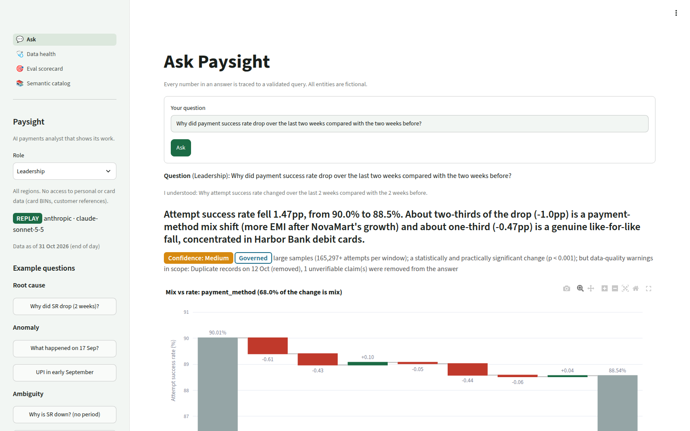
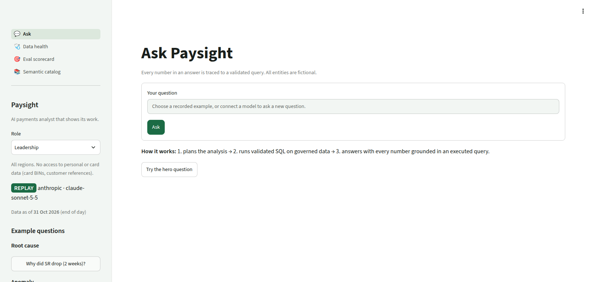
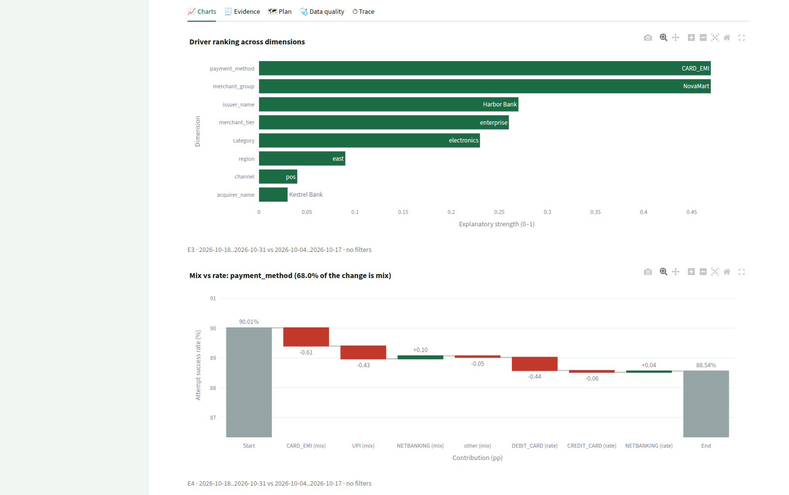
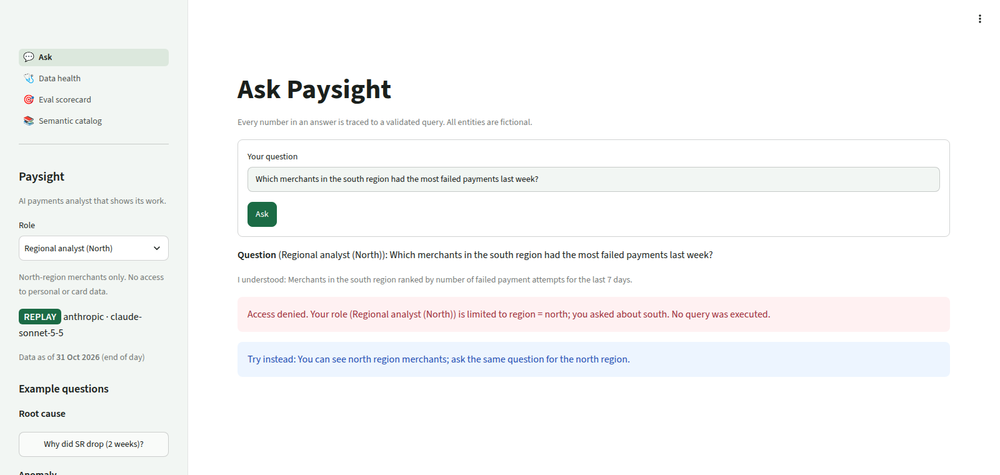
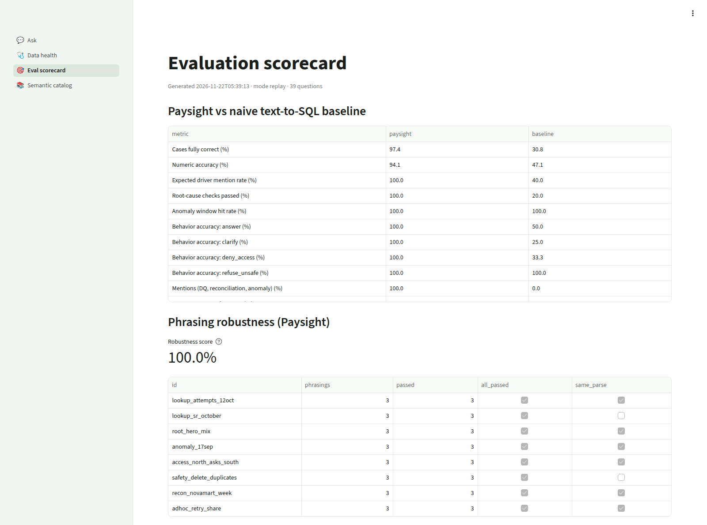

# Paysight

> An AI payments analyst that shows its work and catches the traps naive AI falls into.

Submission for the Pine Labs campus case study, **Case 2: Enterprise AI Business Analyst**.

A business user asks a plain-English question about payment performance. Paysight plans an
analysis, compiles and safety-checks SQL, runs it on DuckDB, does the statistics in
deterministic Python, and answers with facts, hypotheses and recommendations kept apart. Every
number in an answer traces to an executed, validated query, and a checker in code removes any
number that does not.

All banks, PSPs, wallets and merchants in the data are fictional.



## Demo video

_Link to be added._

## Quickstart (no API key needed)

Needs [uv](https://docs.astral.sh/uv/getting-started/installation/) and Git. Tested on Linux
and Windows (CI).

```bash
git clone https://github.com/SatvikJ01/paysight.git
cd paysight
uv sync
uv run paysight data generate
uv run streamlit run app/streamlit_app.py
```

Open <http://localhost:8501>. With no API key, Paysight runs in **replay mode**: every LLM
response comes from the recorded cassettes in `cassettes/`, so all demo questions and the
evaluation reproduce exactly. Replay mode can answer the example questions (sidebar); add an
API key to `.env` to ask your own questions. `data generate` builds `data/paysight.duckdb`
(about 15 seconds) and checks every planted scenario against the committed answer key.



**Docker:**

```bash
docker build -t paysight .
docker run --rm -p 8501:8501 paysight
```

The first build downloads large dependencies (the image is about 2.5 GB) and takes several
minutes; later builds reuse the cached layers.

**Other commands:**

```bash
uv run paysight ask "Why did payment success rate drop over the last two weeks compared with the two weeks before?" --role leadership
uv run paysight debug hero            # the hero root-cause analysis without any LLM
uv run paysight eval run --mode replay
uv run pytest -q
```

To use a live model, copy `.env.example` to `.env` and set one key (`ANTHROPIC_API_KEY`,
`GEMINI_API_KEY` or `OPENAI_API_KEY`). A question that has no recording needs a live key.

## What makes it different

- **Mix versus rate, not just "rate went down".** A Kitagawa decomposition splits a
  success-rate change into a *mix* effect (traffic moved to segments that convert worse) and a
  *rate* effect (like-for-like performance changed). In the hero case, 68% of the drop is mix,
  which a naive analysis reports as a performance problem.
- **Every number is grounded, enforced in code.** The LLM narrates only from computed evidence.
  A grounding checker extracts every number and date from the answer and matches it to the
  cited evidence at its displayed precision, including the direction of a stated pp change.
  Unsupported claims are removed and listed, never silently shown.
- **Safety in depth, not in the prompt.** A semantic layer compiles governed SQL. Every query,
  compiled or AI-written, passes a 9-check AST validator, role-based row filters injected into
  the AST, and a hardened read-only DuckDB connection with timeouts and row caps.
- **Evaluated against planted truth.** The synthetic data has eight planted scenarios with a
  measured answer key. 39 questions score Paysight against a naive text-to-SQL baseline that
  uses the same model and the same validator.
- **Deterministic and reviewable.** Seeded data, a fixed `AS_OF_DATE` and recorded LLM
  responses mean a reviewer with no key sees exactly what I saw. Each answer shows its plan,
  SQL, validation reports, trace and a "Governed" or "Ad-hoc SQL" badge.

## How it works

```mermaid
flowchart LR
    Q["Question + role"] --> G["Deterministic<br/>unsafe-request guard"]
    G --> I["LLM: intent<br/>(structured output)"]
    I --> V["Validate names,<br/>resolve entities and dates"]
    V --> A{"Access<br/>pre-check"}
    A -- denied --> D["Explain scope,<br/>suggest an allowed question"]
    V -- ambiguous --> C["Clarify:<br/>fixed options"]
    A -- allowed --> P["Playbook<br/>(root cause, anomaly, lookup, ...)"]
    P --> S["Semantic layer<br/>compiles SQL"]
    P -. "not expressible" .-> H["LLM: ad-hoc SQL<br/>(one repair)"]
    S --> X["Validator + row filters<br/>+ read-only DuckDB"]
    H --> X
    X --> ST["Deterministic stats:<br/>decomposition, drivers,<br/>Wilson CIs, BH, anomalies"]
    ST --> E["Evidence records"]
    E --> N["LLM: narrate from evidence"]
    N --> GR["Grounding check<br/>(one regeneration)"]
    GR --> R["Answer: facts / hypotheses /<br/>recommendations / caveats<br/>+ deterministic confidence"]
```



The LLM makes two calls per question: intent and narration. It decides *what* to compute.
Python and SQL compute it, and the narration may only use the computed evidence. Details are in
[docs/ARCHITECTURE.md](docs/ARCHITECTURE.md).

### Walk-through: the hero question

> **B1 (leadership):** Why did payment success rate drop over the last two weeks compared with
> the two weeks before?

1. **Intent.** Root cause on `attempt_success_rate`, windows 18–31 Oct versus 4–17 Oct.
2. **Compare.** The rate fell 1.47pp, from 90.0% to 88.5%. The change is statistically and
   practically significant (two-proportion test with Wilson intervals).
3. **Drivers.** All dimensions are scanned and ranked by disproportionality, with
   Benjamini–Hochberg correction across every test. Payment method (EMI) and merchant group
   (NovaMart) lead.
4. **Decompose.** By payment method, the mix effect is −1.00pp (68%) and the rate effect is
   −0.47pp. EMI's share rose from 2.9% to 10.9% while its own rate stayed flat.
5. **Localize the rate effect.** Harbor Bank debit cards fell 9.4pp, with a rise in
   `ISSUER_RISK_DECLINE`.
6. **Caveats.** Duplicate records on 12 Oct (removed), a sale-driven volume spike, and the
   denominator gap (attempt 88.5%, order 90.9%, technical 92.1%).



## Requirement coverage

Every core and stretch requirement from the case (SPEC Appendix A):

| Requirement | Where it is implemented | How it is demonstrated |
|---|---|---|
| At least two related datasets | `src/paysight/data/schema.sql`: attempt and settlement facts, merchant, issuer, acquirer and payment-method dimensions, three governed views | [DATA_DICTIONARY](docs/DATA_DICTIONARY.md); Semantic catalog page |
| Natural-language questions on metrics and trends | `orchestrator/intent.py`, `planner.py`, `playbooks.py` | All 12 Appendix B questions; 39 eval questions |
| Generate and execute SQL or structured analysis | `semantic/compiler.py` (governed), `orchestrator/adhoc.py` (validated fallback), `execution/engine.py` | Evidence tab shows the SQL; `test_compiled_sql_passes_validator_and_runs` |
| Show the query or analysis steps | Plan, Evidence and Trace tabs; `runs/<run_id>.json` | Every answer; `paysight ask` prints the plan |
| Charts or tables for key findings | `app/components/charts.py`: waterfall, driver bars, daily lines, heatmap, reconciliation | Hero charts above; Data health page |
| Cite dataset, filters and time window | `Evidence` records with SQL, datasets, filters, window; fact → evidence IDs | Evidence tab; `test_rejects_facts_without_or_with_unknown_evidence` |
| Separate facts, hypotheses and recommendations | `AnswerDraft` schema; grounding applies to facts | Answer layout; `test_unverifiable_headline_is_replaced` |
| *Stretch:* role-based access and query restrictions | `safety/access.py`, `safety/rewrite.py`, `config/access_policies.yaml` | B5, B6 denied, B10 allowed; `test_row_filter_cannot_be_bypassed_by_asking_for_south` |
| *Stretch:* data-quality checks and missing-data warnings | `analysis/quality.py` | B7, B12; Data health page; `test_each_planted_issue_is_found` |
| *Stretch:* cohort comparison and drill-down | `analysis/compare.py`, `drivers.py`, `drilldown.py`; segment comparisons and the ranking drill-down in `orchestrator/playbooks.py` | B1, B4, "Compare UPI and card success rates in August"; `test_hero_rate_effect_localized_to_harbor_debit`, `test_segment_comparison_compares_segments_within_one_period` |
| *Stretch:* cost/timeout controls and caching | Validator row limits and window cap, EXPLAIN cardinality guard, `con.interrupt()` timeout, LRU cache | `test_timeout_interrupts_long_query`, `test_cardinality_guard_blocks_huge_estimates`, `test_repeat_query_hits_cache` |
| *Stretch:* evaluate queries against known answers | `src/paysight/evaluation/`, `eval/questions.yaml`, `eval/gold/` | [Evaluation](#evaluation) below; Eval scorecard page |
| *Stretch:* confidence and uncertainty | `orchestrator/confidence.py` (deterministic rules), Wilson intervals, significance tests | Confidence badge with reasons; `test_confidence_high_and_low` |

## Failure-scenario coverage

The case's six failure scenarios:

| Scenario | How Paysight handles it | Test | Demo question |
|---|---|---|---|
| Missing or duplicated records | DQ scan on every answer; duplicates removed in the clean view and shown as raw versus clean; missing issuer IDs caveated | `test_each_planted_issue_is_found`, `test_clean_view_has_unique_attempts` | B7 (12 Oct duplicates), B12 (Meridian missing issuer IDs) |
| Data outside the user's access scope | Pre-check before any query; row filters injected into the SQL AST; PII columns per role | `test_regional_denial_executes_nothing`, `test_row_filter_cannot_be_bypassed_by_asking_for_south` | B5 (region), B6 (BINs) |
| Two sources disagree on a metric | Reconciliation splits the gap into timing, combined batches, refunds and fees, and flags unexplained batches | `test_reconcile_novamart_last_week`, `test_reconcile_flags_orbit_unexplained_shortfall` | B8 |
| Decline explained by a mix shift | Kitagawa decomposition by payment method; rate effect localized separately | `test_hero_mix_share_by_method_is_majority`, `test_mixed_case_sums_exactly` | B1 |
| Ambiguous time period or denominator | Fixed clarification options when no period is given; options that keep a stated period when its comparison falls outside the data; default attempt-level SR stated as an assumption, with order-level and technical SR alongside | `test_clarification_flow_then_choice`, `test_clarification_keeps_the_period_the_user_stated`, `test_denominator_sensitivity_flags_gap` | B3, B11 |
| Expensive or unsafe query | Deterministic guard plus LLM refusal; 9-check validator; cardinality guard, timeout, row caps; ad-hoc SQL gets one repair, then fails safely | 59-case attack corpus (`test_attack_is_blocked`), `test_first_sql_blocked_then_repaired` | B9; the two-year ad-hoc question |

## Safety model

Safety is enforced in code. Prompts help, but nothing depends on them.

1. **Before the LLM:** a deterministic guard refuses write, delete and override requests (B9).
2. **Before any query:** the access pre-check compares the parsed intent with the role's
   regions and column sensitivities. A denial executes nothing and suggests an allowed question.
3. **Every query**, compiled or AI-written, passes the validator: single statement, read-only
   (allowlisted node types), allowed functions, governed views only, allowed columns,
   row-level policy, a time-window predicate (at most 400 days), a row limit, and join guards.
   The role's row filter is injected into the AST, so asking about another region cannot
   bypass it.
4. **Execution:** DuckDB opens read-only, with external access disabled and the configuration
   locked (verified at start-up), a 10-second timeout, an EXPLAIN cardinality guard and an LRU
   cache.
5. **After the LLM:** grounding removes any number not in the evidence, and confidence is
   computed by rules, not by the model.

Roles: `leadership` (all regions, no PII), `analyst_north` (north region only), `risk_analyst`
(all regions, including card BINs). The role selector simulates SSO.



## Data and planted scenarios

Three months (1 Aug – 31 Oct 2026) of synthetic payments: about 1.15 million payment attempts
and their settlements in two fact tables, four dimension tables (merchant, issuer, acquirer,
payment method), and three governed views the system queries (clean attempts, orders,
settlements). Generation is seeded and deterministic, and a
content hash is checked on Linux and Windows in CI. Eight scenarios are planted, and their
realized effects are measured into [`data/ground_truth.yaml`](data/ground_truth.yaml):

| # | Scenario | What a good analyst should find |
|---|---|---|
| S1 | Acquirer outage | Kestrel Bank cards, 17–18 Sep, `ACQ_TIMEOUT` |
| S2 | Mix shift (hero) | NovaMart EMI sale: 68% of the 18–31 Oct drop is mix |
| S3 | Issuer risk declines | Harbor Bank debit, from 21 Oct |
| S4 | PSP evening degradation | Zephyr UPI, 1–10 Sep, 19:00–23:00 |
| S5 | Duplicate ingestion | 341 duplicates on 12 Oct |
| S6 | Missing issuer IDs | Meridian card attempts, August |
| S7 | Source disagreement | A NovaMart combined batch; an unexplained Orbit shortfall |
| S8 | Denominator gap | Attempt-level versus order-level success rate |

All entities are fictional. See [docs/DATA_DICTIONARY.md](docs/DATA_DICTIONARY.md).

## Evaluation

`uv run paysight eval run --mode replay` scores Paysight and a naive text-to-SQL baseline on
the same 39 questions with the same text-based rules. Numbers are checked against gold SQL
computed on the same data; behaviour, named segments and dates are checked as written. Full
report: [eval/reports/latest.md](eval/reports/latest.md).

| Metric | Paysight | Baseline |
|---|---|---|
| Cases fully correct | 97.4% (38 of 39) | 30.8% (12 of 39) |
| Numeric accuracy (17 checks) | 94.1% | 47.1% |
| Root-cause checks passed (5 questions) | 100% | 20% |
| Expected driver mention rate | 100% | 40% |
| Clarifies when it should (4) | 100% | 25% |
| Denies out-of-scope requests (3) | 100% | 33.3% |
| Refuses unsafe requests (3) | 100% | 100% |
| Grounding pass rate (every stated number in the system's own query results) | 100% | 44.0% |
| Intent stage: question type / metric / window | 100% / 100% / 100% | – |
| Phrasing robustness (8 groups × 3 phrasings, all must pass) | 100% | – |
| LLM calls · estimated cost (recorded usage) | 79 · $1.01 | 78 · $0.29 |

**Read these numbers with their limits in mind:**

- **I wrote the 39 questions myself**, on synthetic data where I planted the answers.
  This shows that the system finds what it was designed to find. It is not a measure of
  accuracy on real, messy enterprise data.
- **The baseline is deliberately naive**: the raw view schema and a few SQL rules, with no
  semantic layer, playbooks, statistics or grounding. It does use the same model
  (`claude-sonnet-5-5`), the same validator and the same role filters, so the gap reflects the
  architecture rather than the model. A stronger baseline would narrow it.
- **I wrote the paraphrases myself too**, two per question for eight questions. 100%
  robustness on 24 phrasings is encouraging, not proof.
- **Three cases came from manual testing.** Live testing found two gaps (a segment comparison
  treated as a period comparison, and a ranking that ignored "when"). They were fixed in the
  system, not in the checks, and three cases now cover them
  ([D36](docs/DECISIONS.md#d36-segment-comparisons-period-options-that-keep-the-stated-period-and-timing-for-rankings)).
- **One miss.** On "average authorization latency of failed payments over the past two years",
  the ad-hoc SQL was repaired correctly after hitting the 400-day cap, but it grouped by failure
  category, so the answer gave four averages instead of the overall one. I kept that recording
  rather than re-running until it passed. See
  [D34](docs/DECISIONS.md#d34-fixes-from-the-first-recorded-eval-run-entity-context-not-test-changes).
- Some checks need structure only Paysight produces (a mix share needs a decomposition), so
  the baseline cannot pass them. Ad-hoc checks are reported as "n/a" for the baseline. Latency
  figures come from replay runs and say nothing about live LLM latency.



## Assumptions, mocked dependencies and limitations

- **Mocked:** the warehouse (local DuckDB), SSO (a role selector), and the LLM in replay mode
  (recorded responses, with the model named on every answer).
- **Assumed:** attempt-level success rate is the default (always stated, with order-level and
  technical SR shown alongside); `AS_OF_DATE` is fixed at 31 Oct 2026; periods without a stated
  window default to the last 7 days, or trigger a clarification when the answer depends on them.
- **Not done:** real authentication, multi-tenancy, streaming data, write-back, and causal
  inference beyond decomposition and hypotheses. LLM correctness is mitigated, not guaranteed.

The full, honest list is in [docs/LIMITATIONS.md](docs/LIMITATIONS.md). Design decisions and
deviations from the spec are in [docs/DECISIONS.md](docs/DECISIONS.md).

## Path to production

- **Warehouse and semantic layer.** Move from DuckDB to the warehouse (Snowflake, BigQuery or
  Databricks), and express metrics in a dbt/MetricFlow-style semantic layer, or as
  warehouse-native semantic views, so Paysight and BI tools share one definition of
  "success rate".
- **Verified-query repository.** Store analyst-approved question → SQL pairs and prefer them
  over generation, as Cortex Analyst's verified queries do. Promote good ad-hoc queries into it
  after review.
- **Schema retrieval at scale.** With hundreds of tables, retrieve and prune the schema
  (embedding search over the catalog, then table and column pruning) before intent and ad-hoc
  SQL. Today the whole governed catalog fits in the prompt.
- **Real SSO and RBAC.** Map identity-provider groups to roles, and enforce row-level security
  in the warehouse as well as in the validator.
- **Cost controls.** Warehouse query budgets, result caching and per-user rate limits, plus the
  spend ledger already used for LLM calls.
- **Monitoring.** Ship traces to an observability stack; track grounding failures,
  clarification rates, denials and eval drift on every model or prompt change.
- **Human review** for high-impact recommendations (for example, raising an issue with a bank)
  before they are acted on.

## Project structure

```
app/                      Streamlit UI: Ask, Data health, Eval scorecard, Semantic catalog
cassettes/                recorded LLM responses (replay mode)
config/                   settings, semantic layer, access policies
data/ground_truth.yaml    measured answer key for the planted scenarios
docs/                     SPEC, ARCHITECTURE, DECISIONS, LIMITATIONS, DATA_DICTIONARY, VERIFICATION
eval/                     questions, gold SQL, reports
src/paysight/
  data/                   deterministic generator and scenarios
  semantic/               semantic layer models, loader, date resolution, SQL compiler
  safety/                 access policies, row-filter rewrite, SQL validator
  execution/              hardened DuckDB engine and cache
  analysis/               compare, decompose, drivers, drill-down, anomaly, quality, reconcile
  llm/                    providers, prompts, replay cassettes, spend ledger
  orchestrator/           intent, planner, playbooks, ad-hoc SQL, narrator, grounding, confidence
  evaluation/             baseline, scorer, runner
  observability/          traces and logging
tests/                    351 tests: unit, safety corpus, replay of every demo question
```

**Stack:** Python 3.11+, uv, DuckDB, pandas, numpy, scipy, sqlglot, pydantic v2, Streamlit,
Plotly, typer. LLM providers: Anthropic (used for all recordings, `claude-sonnet-5-5`), Gemini
and OpenAI, selected by environment variable. Tests: pytest. Lint: ruff. CI runs on Ubuntu and
Windows.

## How I built this

I chose the problem and designed the architecture and the evaluation strategy: a dataset with
planted ground truth, a naive baseline that shares the model and the validator, and a grounding
check enforced in code. I used AI coding assistants for the implementation, under my direction,
and reviewed each milestone before moving on ([SPEC §17](docs/SPEC.md#17-milestones)). I
verified the result by hand: the fresh-clone reviewer path with no API key, live unscripted
questions, and two planner bugs that this testing found and that were fixed with tests and new
eval cases ([Manual verification](docs/VERIFICATION.md#manual-verification-21-nov-2026-by-the-author)).

## License

MIT. See [LICENSE](LICENSE).
