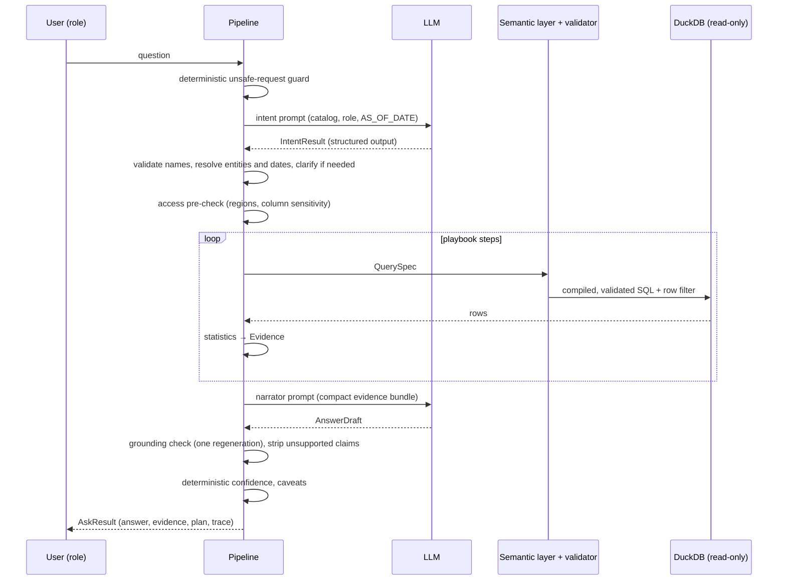

# Architecture

Paysight answers one question per run. The LLM decides *what* to compute (intent) and writes the
answer from computed evidence (narration). Everything in between is deterministic Python and
validated SQL. This document covers the components, the data flow and the interfaces between
them. Design reasons are in [DECISIONS.md](DECISIONS.md).

## Components

| Layer | Package | Responsibility |
|---|---|---|
| Data | `paysight.data` | Seeded generator for the dimension and fact tables, the eight planted scenarios, and the measured ground truth. `schema.sql` defines the raw tables and the three governed views. |
| Semantic layer | `paysight.semantic` | `config/semantic_layer.yaml` → pydantic models (metrics, dimensions, synonyms, sensitivities, context dimensions). `dates.py` resolves time expressions against `AS_OF_DATE`. `compiler.py` turns a `QuerySpec` into SQL with the sqlglot builder (never string concatenation). |
| Safety | `paysight.safety` | `access.py`: role policies and the pre-check on the parsed intent. `validator.py`: the 9-check AST validator. `rewrite.py`: injects the role's row filter into the AST. |
| Execution | `paysight.execution` | `Engine`: a read-only DuckDB connection (external access off, configuration locked and verified), a timeout through `con.interrupt()`, an EXPLAIN cardinality guard, and an LRU result cache. |
| Analysis | `paysight.analysis` | Pure functions over query results: period comparison with Wilson intervals and two-proportion tests, Kitagawa decomposition, driver ranking with Benjamini–Hochberg correction, drill-down, robust-z anomaly windows, data-quality scan, reconciliation. |
| LLM | `paysight.llm` | `Provider` implementations (Anthropic, Gemini, OpenAI, fake). `StructuredLLM` adds retries and one schema re-ask. `LLMClient` adds live, record and replay modes over cassettes and the spend ledger. Prompts are versioned Markdown files. |
| Orchestrator | `paysight.orchestrator` | `pipeline.Paysight.ask` runs the flow below. `playbooks.py` holds one runner per question type. `adhoc.py` is the validated SQL fallback. `narrator.py`, `grounding.py` and `confidence.py` turn evidence into an answer. |
| Evaluation | `paysight.evaluation` | Question loading, the naive baseline, text-based scoring and the report. |
| Observability | `paysight.observability` | One trace per question (`runs/<run_id>.json`): timed steps, LLM tokens and cost, validation reports, denials, evidence metadata. |
| UI | `app/` | Streamlit pages: Ask, Data health, Eval scorecard, Semantic catalog. |

## Data flow for one question

1. **Guard.** `unsafe_reason()` refuses write, delete and override requests before any LLM call.
2. **Intent.** One structured call returns `IntentResult`: question type, metrics, dimensions,
   filters, time expressions, ambiguities, optional extra steps, and whether custom SQL is
   needed. The model sees the governed catalog, not the raw schema.
3. **Validate and resolve.** Unknown names are dropped with a note. Entity values are matched to
   the data ("novamart" → `merchant_group = 'NovaMart'`). Time expressions resolve against
   `AS_OF_DATE`. Material ambiguity returns fixed clarification options and runs no query.
4. **Access pre-check.** Regions and column sensitivities in the intent are checked against the
   role. A denial explains the scope, suggests an allowed question, and executes nothing.
5. **Playbook.** The runner for the question type issues `QuerySpec`s through
   `Engine.run_spec`. Each result becomes an `Evidence` record. If the semantic layer cannot
   express the question, `run_adhoc` asks the LLM for SQL against the role's view schema and
   the resolved filters, validates it, and allows one repair.
6. **Data quality.** Every answer runs a DQ scan scoped to its window and role, so warnings such
   as duplicates or missing issuer IDs appear as caveats.
7. **Narrate.** The narrator sees a compact evidence bundle: IDs, titles, windows, filters, key
   numbers and top rows. It never sees `Evidence.meta`.
8. **Ground.** `check_draft` extracts every number and date from the headline and facts and
   requires each to match the cited evidence at its displayed precision. On failure, the
   narrator gets one regeneration with the exact failures. Remaining unsupported claims are
   removed and listed. An unsupported headline is replaced.
9. **Confidence.** Rules over sample size, significance, data-quality findings, ad-hoc SQL and
   removed claims give High, Medium or Low, with reasons.

## Key interfaces

| Interface | Defined in | Contract |
|---|---|---|
| `QuerySpec` | `semantic/models.py` | Metrics, dimensions, filters (typed values, never SQL text), time window, order, limit. The only way playbooks ask for data. |
| `compile_query(spec, layer) → CompiledQuery` | `semantic/compiler.py` | Deterministic SQL with tie-broken ordering. Raises `CompileError` when the spec cannot be expressed (which triggers the ad-hoc fallback). |
| `validate_sql(sql, role, …) → ValidationReport` | `safety/validator.py` | Runs all 9 checks in order, lists every check (pass, fail or skipped), and returns the rewritten SQL with the row filter and limit applied. |
| `Engine.run_spec / run_sql / run_internal` | `execution/engine.py` | `run_spec` and `run_sql` always validate. `run_internal` runs fixed, reviewed SQL (DQ and reconciliation) with bound parameters and is never reachable from LLM output. |
| `Evidence` | `orchestrator/models.py` | One analysis step's verifiable output: SQL, validation reports, datasets, filters, window, rows, `key_numbers` (business figures the narrator may state), `meta` (pipeline counters it may not), chart data, ad-hoc flag. |
| `LLMClient.complete(prompt, schema, **values) → (model, Usage)` | `llm/replay.py` | Renders a versioned prompt, then replays or calls the provider with a JSON-schema response format. Cassette key = sha256 of template, version, rendered prompt and schema name. |
| `AnswerDraft` / `AskResult` | `orchestrator/models.py` | The narrator's structured answer, and everything the UI and CLI show, including removed claims, the pre-grounding draft, confidence, plan, evidence and `sql_source`. |

## Determinism

- **Data.** Named RNG streams (`SeedSequence([seed, crc32(name)])`) and a content hash that CI
  checks on Ubuntu and Windows.
- **Time.** `AS_OF_DATE` is fixed at 2026-10-31, and every relative period resolves against it.
- **SQL.** Compiled SQL is byte-stable (snapshot tests), and every `ORDER BY` gets tie-breakers.
- **LLM.** Replay mode serves recorded responses keyed by the exact prompt. Any change to a
  prompt or to the evidence bundle shows up as a missing cassette, never as a silent difference.
